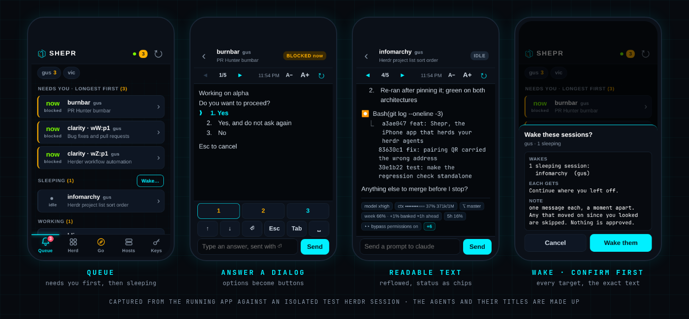

<p align="center"></p>

<p align="center"><b>An iPhone home-screen app that shows which agent sessions, on which hosts, are waiting on you.</b><br>
Tap one, read it, answer it. Sends confirm first, and it never approves anything by itself.</p>

Built with the [nixweb.app](../nixweb.app) method: a web page on your tailnet. No Xcode, no App Store, no build step,
no framework, no npm. Idea #2 in nixweb's `IDEAS.md`: "the killer one", because agents block on a question and then
idle for an hour with nobody at the keyboard.

<p align="center"></p>

## How it fits together

<p align="center"></p>

The phone talks to **one** host. That host reaches the rest with `herdr --machine <label>` over the SSH keys you already
have. Nothing listens beyond `127.0.0.1`; `tailscale serve` is the only way in, and it only answers your tailnet.

It is HTTPS because it has to be: iOS refuses WebCrypto (the phone's key), the camera (the QR scan) and service
workers on plain `http://`. `tailscale serve` supplies a real certificate on your tailnet name.

## Use it

```bash
# once, on the host (gus):
~/Projects/nixweb.app/bin/nixweb install herder.remote.iphone 8742   # systemd --user unit + tailscale serve
shepr pair                                                           # shows a QR code
```

On the iPhone, in **Safari**: open `https://gus.tail0940f.ts.net:8742`, Share, **Add to Home Screen**. Open **Shepr**
from the Home Screen, tap **Scan QR**, point it at the code in your terminal, tap **Pair**.

<p align="center"></p>

## What is on screen

| Tab | What |
|---|---|
| **Queue** | Everything, in the order that matters: **Needs you** (longest blocked first), **Finished**, **Working**, then **Sleeping** last (with a **Wake…** button). Sessions are named after your herdr workspace ("Shepr"), falling back to the project directory. Badge shows what needs you. | It refreshes itself every 10 s while the app is open and the moment you come back to it; pull down from the top of any list to refresh on demand.
| **Herd** | Every session on every host, grouped by host. |
| **Go** | Search every session by project, session title or host. Waiting first, then recent. |
| **Hosts** | Hosts herdr can reach (turn saved ones on or off) and a tailnet scan for more. |
| **Keys** | This phone's key, the phones the host trusts (revoke), pair another, **Top spacing**, and the app build (`Shepr v8`) so you can tell which version a phone is running. |

Every session is called by its **project** (the directory it runs in), with herdr's session title, the last thing it
worked on, underneath. Two sessions in one project get their pane id so you can tell them apart.

### Moving around

<p align="center"></p>

None of these ever sends anything.

### Reading a session

The pane is a terminal: 100+ fixed-width columns. On a phone that wraps mid-line with no alignment, so Shepr
re-lays it out. Prose reflows in the normal font with a hanging indent (bullets and numbers stay aligned), code,
tables, paths and tool output stay fixed-width, rules become thin dividers, an empty prompt box is one divider, and the status bar under the prompt becomes a
compact strip of chips: model, context, banked / weekly subscription, 5h window, branch and permission mode, with
the rest behind one **+N** tap. **A−** / **A+** change the size (it remembers). Text only ever goes through `textContent`: whatever an
agent prints is data, never markup.

### Skills and slash commands

In a session, tap **/** next to the message box (or just type `/`): a row shows the **last 6 skills and commands you
actually used**, newest first (read from Claude Code's own prompt history on the host). Tap one and it fills the box
with `/name `; it never sends. **MORE** opens a searchable list of everything on the host (your skills, plugin skills,
built-in commands), matching names and descriptions. Typing `/be…` filters the row as you go. `/exit` and `/quit` are
never offered as a one-tap chip, and a session sitting at a dialog gets no slash row (typing goes into the dialog).
A slash command still goes through the preview-and-confirm sheet like any prompt. For a remote host only the built-in
commands are listed: its skills are not read from here.

### Wake

**Sleeping > Wake…** lists the idle sessions (all ticked) and one message (default "Continue where you left off.").
**Review** shows every target and the exact text; **Wake them** sends one prompt each, half a second apart. It only
**Tick-several questions** (Claude's multi-select, `[ ]` boxes): tap the numbers to tick them on your phone, then **Submit…** (or **Next…** inside a multi-question form) shows what will be ticked and which keys go, and you confirm. Each digit is sent as its own keypress, because Claude reads a burst of digits as pasted text and ticks nothing. "Type something" is not tickable from the phone yet.
ever touches **idle or finished** sessions: a blocked one is a question waiting on you, and is refused outright, so
this can never answer or approve a dialog. A session that moved on since you looked is skipped. It declines while
the host's load is above its core count.

## Sending

<p align="center"></p>

A send is two requests. `prepare` returns exactly what will happen (the keys, the text, which agent, what state it
is in) plus a one-use nonce. `commit` runs it. The preview is bound to the agent's `state_change_seq`: if the agent
moved on while you looked, nothing is sent. A failed send is reported and never retried; a failed write may still
have landed, and the message says so.

- A blocked agent gets keys, not prompts: option buttons (it works out the ↓ presses from the screen), an
  arrow/Enter/Esc pad, or a typed line. Options that read like approvals are marked amber and the confirm sheet says so.
- An idle agent gets a normal prompt. A working agent only accepts `Esc` (interrupt) or a queued prompt.
- No ctrl-chords from a phone. `SHEPR_READONLY=1` turns every write off.

## Pairing and keys

The phone makes an ECDSA P-256 key with `extractable: false`; it can sign with it and nothing can read it back.
`shepr pair` writes a one-time code (60 bits, 3 minutes, single use, stored hashed) and prints a QR of
`https://<host>:8742/#shepr-pair=XXXX-XXXX-XXXX`. The app scans it, sends its **public** key with the code, and the
host files it in `~/.local/state/shepr/devices.json`, like an `authorized_keys` entry.

Every later request is signed over `time, nonce, method, path, sha256(body)`. The host refuses a replay, a changed
path or method, an old timestamp, an unknown or revoked key. Five wrong codes in a minute locks pairing for a minute.

```
shepr pair [--ttl 180] [--png qr.png] [--json] [--no-wait]
shepr devices            # list paired phones with SSH-style SHA256 fingerprints
shepr revoke <name|id>   # sign a phone out now
```

**This is not an SSH key.** A home-screen web app cannot speak SSH or hold an OpenSSH key; WebCrypto can. The device
key authenticates the phone to Shepr. Hops from the host to other machines use ordinary SSH keys through herdr's
saved machines. On top of that, every request must come through tailscale from the node owner's login with the right
`Host` header; public funnel traffic, other tailnet users and cross-origin posts are refused.

## More hosts

**Hosts > Scan tailnet** tries `ssh` with this host's key, never prompting, to the online machines that **belong to
you** (nodes shared in from another user are never touched), and reports each as `ready` (herdr found: **Add**),
`needs key` (**Copy key** gives a one-line command that appends this host's public key to `authorized_keys`),
`first connect` (run `ssh host` once and check the fingerprint; Shepr never trusts a new host key on its own),
`no herdr` (checked on the plain PATH and in the login shell), or `unreachable`. Add and on/off go through the same
preview-and-confirm sheet and run `herdr machine add|enable|disable`.

## Honest limits

- "Blocked for" is measured: herdr gives an event counter, not a clock. The host polls herdr every 15 s and
  remembers when it first saw each blocked state; for local Claude sessions that were already blocked it uses the
  transcript's last-write time. A leading `≥` means it was already blocked when watching began.
- Verified here: the server, the signing scheme (WebCrypto signatures checked by the pure-Python verifier), QR
  generation and scanning (fake camera feed through jsQR), gestures, wake, the text renderer, layout at iPhone 14
  size, offline start, and a real tailnet scan. **Not verified on a physical iPhone**: camera permission in a Home
  Screen app, keyboard behaviour, the launch images. `Keys > Top spacing` exists because a real phone clipped the header.
- Sending a prompt to an idle agent could not be exercised against a real agent in the isolated test session
  (herdr refuses a fake agent that is not the pane's foreground process).
- iOS may delete a Home Screen app's storage if it is removed; the key goes with it. Pair again.
- One Shepr per phone install: the app is served from one origin.

## Layout

```
server.py            static files, /ping, /api, and the shepr CLI (pair|devices|revoke). Standard library only.
index.html app.css app.js sw.js manifest.webmanifest
icons/               logo.svg, app icons, launch images (iOS shows these before any code runs)
vendor/jsQR.js       the one third-party file: Safari has no BarcodeDetector. Apache-2.0, see vendor/README.md
docs/img/            the graphics above (hand-built SVG) and real screenshots
tests/               ui.mjs, sw_offline.mjs, format.mjs, pair_cli_test.py, fake-session.sh, shots.mjs
```

State: `~/.local/state/shepr/` (`devices.json`, `seen.json`, `pairing.json`, `sends.jsonl` audit log), mode 0600.
Logs: `journalctl --user -u nixweb-herder.remote.iphone -f`. The app shell is fetched network-first (2.5 s, then
cache) so a change shows on the next open and the app still opens offline.
The host also announces the current build (`/api/hello`, `/api/queue`). A Home Screen app can stay alive in iOS
memory for days, so a phone running an older build reloads itself at the first safe moment (on the list, nothing
typed, no sheet open); inside a session it shows an **Update** button instead. It never reloads under your thumb.

## Testing without touching real agents

```bash
tests/fake-session.sh up                       # isolated herdr session "hrtest" with fake agents
eval "$(tests/fake-session.sh env)"; SHEPR_URL=http://localhost:8743 python3 server.py 8743 &
node tests/ui.mjs; node tests/sw_offline.mjs; node tests/format.mjs; python3 tests/pair_cli_test.py
node tests/shots.mjs                           # regenerates docs/img/screens.png from the RUNNING app
tests/fake-session.sh down
```

The screenshots are captures, never mocks. The agents and their titles in them are made up.
